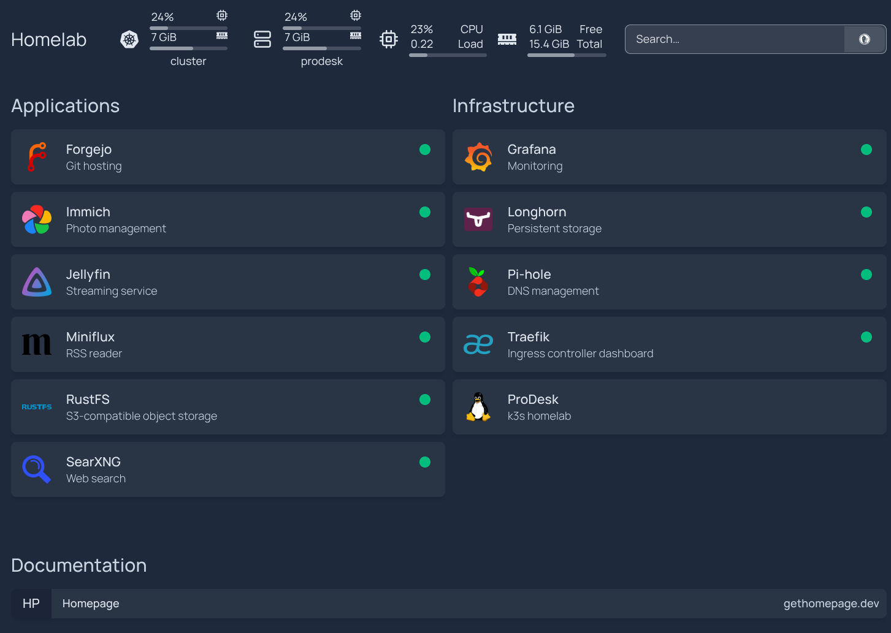

Overview of my homelab.
<!--more-->

## Hardware

Current hardware is mixture of computers on different occasions, so it is not purpose built setup.

Setup covers (bound together with 5G router):
- 5 port switch
  - HP Prodesk 600 G4 (Intel NUC) with 16GB memory, 256GB internal SSD and 2TB USB-C HDD
  - Raspberry Pi with 1TB USB SSD on USB3
- Macbook Pro 2018 with 32GB memory and 1TB internal SSD

## Software

All hosts are some version of Linux distribution with ansible. They have been
then customized with handmade ansible playbooks (might switch to Nix, if I ever
reinstall one). On prodesk, ansible-playbook will bootstrap k3s with flux and
everything inside that k3s cluster is managed via flux.

### Linux distributions

- prodesk has Fedora Server (with xfs)
- raspberry has Raspberry OS Lite (so basically Debian with xfs)
- touchbar (Macbook Pro) has Fedora Workstation's T2 Linux version (with brtfs)

### Ansible playbooks

- prodesk has k3s+flux and samba in addition to shared
- raspberry has homeassistant in addition to shared
- touchbar has Linux desktop environment (based on niri)

GitHub repository with all these: https://github.com/jylitalo/homelab-linux

### GitOps

- prodesk is hosting git repository under single Linux user as a source for flux
- secrets are handled with SOPS+age
- GitHub: https://github.com/jylitalo/homelab-gitops
  - apps
    - forgejo
    - homepage
    - immich
    - jellyfin
    - miniflux
    - nginx
    - searxng
  - infrastructure
    - alloy
    - cert-manager
    - cloudflared
    - cloudnative-pg (cnpg)
    - grafana
    - loki
    - longhorn (storage)
    - metallb
    - pihole (DNS)
    - prometheus
    - rustfs (AWS S3 compatible storage)
    - traefik

## TODO

- add raspberry as worker node
- add authentik to provide SSO
- replace SOPS+age secrets with Hashicorp's Vault
- move forgejo's ssh port to 22 with metallb
- additional host into k3s and change raspberry from worker to control-plane
- add tailscale
